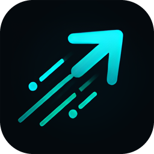

<p align="center">
  
</p>

# MegasMoves | Open-Source SI Agent & Multi-Device Automation

**Your always-on SI agent for all your devices.**

MegasMoves (also called Megas Moves) is an open-source **SI agent platform** and **developer automation runtime** that connects compatible agents to local tools, trusted workspaces, browser tabs and device-specific operations using the **Model Context Protocol (MCP)**. It is designed around observable execution, explicit permissions and human-visible work. The public builds and integrations are an evolving engineering preview.

**[Website](https://megasmoves.io/)** · **[Installation & downloads](https://megasmoves.io/download/)** · **[Getting started](https://megasmoves.io/docs/getting-started/)** · **[MCP / CLI documentation](https://megasmoves.io/docs/cli-reference/)** · **[Security policy](SECURITY.md)**


**MegasMoves** by **Amretra Dynamics** is a multi-device software automation platform built around native applications, a local execution runtime, the Model Context Protocol (MCP), and explicit device and workspace permissions.

**Community:** [Join MegasMoves on Telegram](https://t.me/megasmovesSI) · [Follow on X](https://x.com/MegasMoves) · [Website](https://megasmoves.io/)

## What you can explore

- **Local tools and runtimes:** inspect developer workspaces, processes, service readiness and logs through typed interfaces.
- **MCP integrations:** give compatible agent clients explicitly scoped operator capabilities, not unrestricted machine access.
- **Browser automation:** interact with approved Chrome tabs via an opt-in extension, with operation boundaries and observable outcomes.
- **Cross-platform engineering:** Windows native operator, Android client and platform-specific macOS/Linux components.
- **Work continuity:** organize actions, file references, tasks and handoffs through the same operator.

The release status and supported functions vary by operating system. Check [Downloads](https://megasmoves.io/download/) and [documentation](https://megasmoves.io/docs/) before depending on a capability.

## Architecture

The MegasMoves system spans several layers:

| Layer | Architecture |
| --- | --- |
| **Megas runtime** | Python application and capability orchestration |
| **MegasMCP** | Typed MCP transport and operator interfaces |
| **Megas Browser** | Dedicated Chromium/Playwright operation, session state and approval boundaries |
| **Native desktop** | WinUI 3 on Windows, Swift on macOS, GTK/C++ on Linux |
| **Megas Actions** | Action grouping, local task records and scoped file/folder references |
| **Native execution** | C++ runtime boundary and platform bridges |
| **Android** | Kotlin application and mobile-device surface |

## Actions, skills and native windows

Run `python -m pip install .` from this checkout and connect an MCP client to
`megas connect`. The standalone package can save a user-selected voice plan
as one Action with Tasks. Repeating the request with the same voice entry ID
returns the original plan. Local task views omit project-linked records.

With the current Megas Moves Linux application installed and signed in, the
same connection also supports these workflows.

- Run `megas plugins add NAME --url URL --transport streamable-http`, then
  `megas plugins probe NAME` and `megas plugins allow NAME TOOL` for each
  tool you choose. Connections in the desktop app offers the same controls.
  `megas_skill_capabilities` lists the granted tools and their input schemas.
- Use `megas_skill_save` to save ordered steps under an Action. Steps can
  call a granted MCP tool, test its previous result, create a Task or include
  a specific revision of another skill. Triggers include manual runs, times,
  local task transitions and agent turn completion. Use `megas_skill_history`
  to inspect run receipts.
- Use `megas_auto_routine_settings` for local sleep and wake times. Adaptive
  timing is opt-in. A goal runs only while the operator is online and has a
  grant for the specific day or overnight skill revision. A goal can end
  when its target Task completes. `megas_auto_routine_report` shows results.
- On Linux X11, `linux_ui_windows` reports native OS windows and known human
  or agent activity. `linux_ui_agent_window` opens a separate top-level work
  window. Keep its resume token to reuse it. The native operator checks the
  signed-in owner, window identity and the device's Operate permission.

The skill and routine engines are available under `worker/megas`. Embedding
hosts supply the verified owner, approved plugin registry, and any optional
review mailbox or activity observer. The Android library under
`app/voice-history` provides the encrypted local history, review screen and
plan handoff for a signed-in host app. The Android MCP library in
`app/android-mcp` discovers the tools exposed by an explicitly paired HTTPS
worker after checking the current owner, selected route and read scope.
Chitraagni customers use the website operated by the product team. The Megas client communicates with it through
the customer's authorized connection.

## Chrome browser connector

MegasMoves includes an opt-in Manifest V3 Chrome extension for controlling explicitly enabled tabs in an existing Chrome window. Unlike the dedicated Megas Browser, the extension uses a local native-messaging host and grants access one tab at a time. See [Chrome connector installation and safety](extension/chrome/README.md). It is currently a source-installed engineering preview.

## Developer interface

The CLI entrypoint is **`megas`**. The Python distribution uses the name **`megasmoves`**.

```sh
pip install https://megasmoves.io/downloads/megasmoves-0.5.0-py3-none-any.whl
megas connect
```

The published Python package provides the `megas` command. On Windows it delegates
to the same installed MegasMoves application, installing it on first use if needed.
The short `pip install megasmoves` command is pending PyPI publication.

Visit [Downloads](https://megasmoves.io/download/) for native installation commands,
preview Windows/Android downloads, retained macOS/Linux CLI builds, versions and
checksums. These preview artifacts are not a signed production release.

Website updates are built locally and published using the
[website deployment guide](.github/WEBSITE_DEPLOYMENT.md).

## Engineering principles

MegasMoves uses typed capability contracts, local permissions and bounded operations to give agents access to software tools and devices. The system includes source-level separation between operation requests, transport, runtime state, native device bridges, and the services that execute them.

The codebase is organized under `worker/` for Megas runtime and native desktop components, with additional product surfaces maintained as part of the overall system architecture.

## Project

- **Company:** Amretra Dynamics
- **Product:** MegasMoves
- **Interface:** `megas`
- **License:** [MIT](LICENSE)
- **Security:** [Security policy](SECURITY.md)

© Amretra Dynamics.
