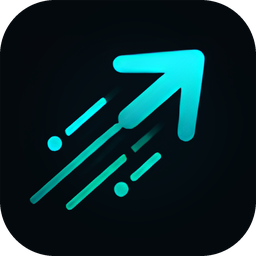

<p align="center">
  
</p>

# MegasMoves

**Your always-on SI agent for all your devices.**

**MegasMoves** by **Amretra Dynamics** is a multi-device software automation platform built around native applications, a local execution runtime, the Model Context Protocol (MCP), and explicit device and workspace permissions.

## Architecture

The MegasMoves system spans several layers:

| Layer | Architecture |
| --- | --- |
| **Megas runtime** | Python application and capability orchestration |
| **MegasMCP** | Typed MCP transport and operator interfaces |
| **Megas Browser** | Dedicated Chromium/Playwright operation, session state and approval boundaries |
| **Native desktop** | WinUI 3 on Windows, Swift on macOS, GTK/C++ on Linux |
| **Megas Actions** | Action grouping, local task records and scoped file/folder references |
| **Native execution** | C++ runtime boundary and platform bridges |
| **Android** | Kotlin application and mobile-device surface |

## Chrome browser connector

MegasMoves includes an opt-in Manifest V3 Chrome extension for controlling explicitly enabled tabs in an existing Chrome window. Unlike the dedicated Megas Browser, the extension uses a local native-messaging host and grants access one tab at a time. See [Chrome connector installation and safety](extension/chrome/README.md). It is currently a source-installed engineering preview.

## Developer interface

The CLI entrypoint is **`megas`**. The Python distribution uses the name **`megasmoves`**.

```sh
pip install https://megasmoves.io/downloads/megasmoves-0.5.0-py3-none-any.whl
megas connect
```

The published Python package provides the `megas` command. On Windows it delegates
to the same installed MegasMoves application, installing it on first use if needed.
The short `pip install megasmoves` command is pending PyPI publication.

Visit [Downloads](https://megasmoves.io/download/) for native installation commands,
preview Windows/Android downloads, retained macOS/Linux CLI builds, versions and
checksums. These preview artifacts are not a signed production release.

Website updates are built locally and published using the
[website deployment guide](.github/WEBSITE_DEPLOYMENT.md).

## Engineering principles

MegasMoves uses typed capability contracts, local permissions and bounded operations to give agents access to software tools and devices. The system includes source-level separation between operation requests, transport, runtime state, native device bridges, and the services that execute them.

The codebase is organized under `worker/` for Megas runtime and native desktop components, with additional product surfaces maintained as part of the overall system architecture.

## Project

- **Company:** Amretra Dynamics
- **Product:** MegasMoves
- **Interface:** `megas`
- **License:** [MIT](LICENSE)
- **Security:** [Security policy](SECURITY.md)

© Amretra Dynamics.
